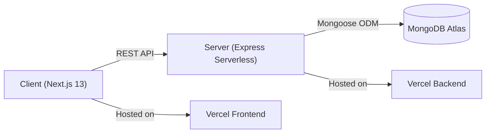

# 🛍️ UU E-SHOP — Modern Full-Stack E-Commerce Platform

A production-ready, performant, and scalable full-stack e-commerce solution built with **Next.js 13**, **Tailwind CSS**, **Node.js**, **Express**, and **MongoDB Atlas**, optimized for serverless deployments on **Vercel**.

Developed with ❤️ by **UU Team**.

---

## 🌟 Key Features

### 🛒 Customer Storefront
- **Modern Responsive Design:** Crafted with Tailwind CSS and DaisyUI, seamlessly responsive across mobile, tablet, and desktop screens.
- **Product Catalog & Dynamic Categorization:** Fast product search, category browsing, filtered catalog with pricing tiers and stock indicators.
- **Product Details & Gallery:** Multiple image preview, product variants (size/color/pricing), description, and customer reviews.
- **Cart & Direct Checkout:** One-click instant checkout (`direct-buy`) or traditional shopping cart management with local storage persistence.
- **Shipping & City Auto-Detection:** Bangladeshi district/city-based dynamic delivery fee calculation.
- **Coupons & Wallet Support:** Integrated promo coupon verification and customer wallet discount deduction system.

### ⚙️ Admin Dashboard
- **Analytics & Revenue Overview:** Interactive Chart.js visualizations for daily sales, revenue calculation, and order tracking.
- **Product Management:** Full CRUD operations for products, variants, image URLs, stock levels, and promotional discounts.
- **Order Management:** Real-time order monitoring, invoice generation, and status management (Pending, Processing, Delivered, Cancelled).
- **Category & Banner Controls:** Dynamic management of home banner sliders and promotional banners.
- **Customer & Staff Management:** Role-based access control (Admin, Staff, Customer) with secure authentication.

---

## 🏗️ Architecture & Tech Stack



- **Frontend:** Next.js 13 (Pages Router), React 18, React Query, Tailwind CSS, DaisyUI, Chart.js, Framer Motion.
- **Backend:** Node.js, Express, Mongoose, JWT (JSON Web Token), BcryptJS, Validator.
- **Database:** MongoDB Atlas (Multi-shard Replica Set).
- **Hosting & CI/CD:** Vercel (Client and Serverless Function deployments).

---

## 🚀 Live Deployments

- **Frontend Application:** [https://e-shop-project-gdkd.vercel.app](https://e-shop-project-gdkd.vercel.app)
- **Backend API:** [https://e-shop-project-omega.vercel.app](https://e-shop-project-omega.vercel.app)
- **API Status Endpoint:** `https://e-shop-project-omega.vercel.app/`

---

## 📂 Project Structure

```text
UU E-SHOP/
├── client/                     # Next.js Frontend
│   ├── lib/                    # Configuration, auth helpers & API services
│   ├── pages/                  # Next.js pages & routing
│   │   ├── admin/              # Admin dashboard & management pages
│   │   ├── auth/               # Login, registration, password recovery
│   │   ├── checkout/           # Shopping cart & direct purchase checkout
│   │   ├── product/            # Single product detail pages
│   │   └── index.js            # Home page storefront
│   ├── public/                 # Static assets & icons
│   ├── src/                    # Shared components, hooks & modals
│   └── next.config.js          # Next.js build configuration & image domains
│
└── server/                     # Node.js Express Backend
    ├── src/
    │   ├── config/             # DB connection with connection pooling & caching
    │   ├── Controllers/        # Business logic controllers
    │   ├── middlewere/         # JWT verification & admin guard middlewares
    │   ├── Models/             # Mongoose schemas (Products, Orders, Users, etc.)
    │   ├── Routes/             # Express API routing definitions
    │   ├── services/           # Reusable data layer services
    │   └── index.js            # Express application entrypoint
    ├── vercel.json             # Vercel serverless build and routing configuration
    └── package.json            # Server dependencies
```

---

## ⚙️ Environment Variables

### Backend (`server/.env` & Vercel Backend)
```env
PORT=5000
NODE_ENV=production
MONGO_URI=mongodb+srv://<username>:<password>@cluster0.cujzbpx.mongodb.net/shopDB?retryWrites=true&w=majority
TOKEN_SECRET=<your_jwt_secret_token>
ACTIVATION_SECRETE=<your_activation_secret>
clientUrl=https://e-shop-project-gdkd.vercel.app
```

### Frontend (`client/.env.local` & Vercel Frontend)
```env
NEXT_PUBLIC_SERVER_URL=https://e-shop-project-omega.vercel.app
```

---

## 🛠️ Local Development Setup

### 1. Prerequisites
- [Node.js](https://nodejs.org/) (v18.x or later recommended)
- [Git](https://git-scm.com/)

### 2. Clone the Repository
```bash
git clone https://github.com/hayatullabd/E-SHOP-PROJECT.git
cd E-SHOP-PROJECT
```

### 3. Backend Setup
```bash
cd server
npm install
# Ensure .env is populated with MongoDB credentials
npm run dev
# Server will run on http://localhost:5000
```

### 4. Frontend Setup
```bash
cd ../client
npm install
npm run dev
# Storefront will run on http://localhost:3000
```

---

## 👥 Credits & Team

- **Development & Architecture:** **UU Team**
- **Institution:** Uttara University (UU)

---

## 📄 License
This project is licensed under the [ISC License](LICENSE).
